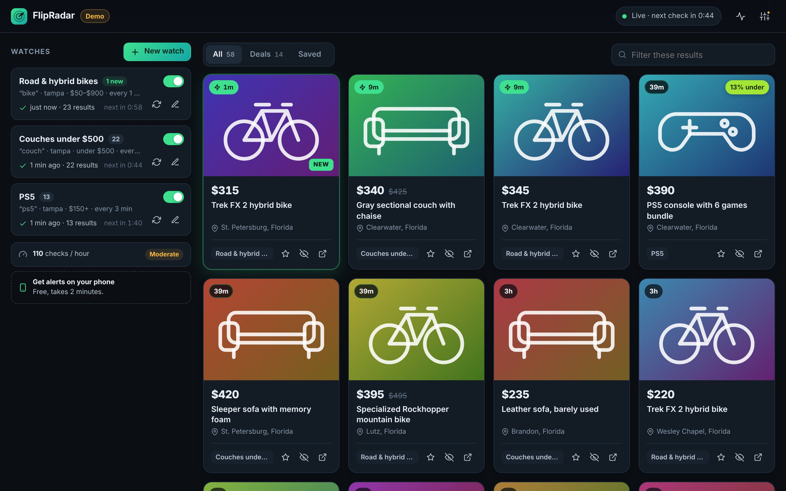
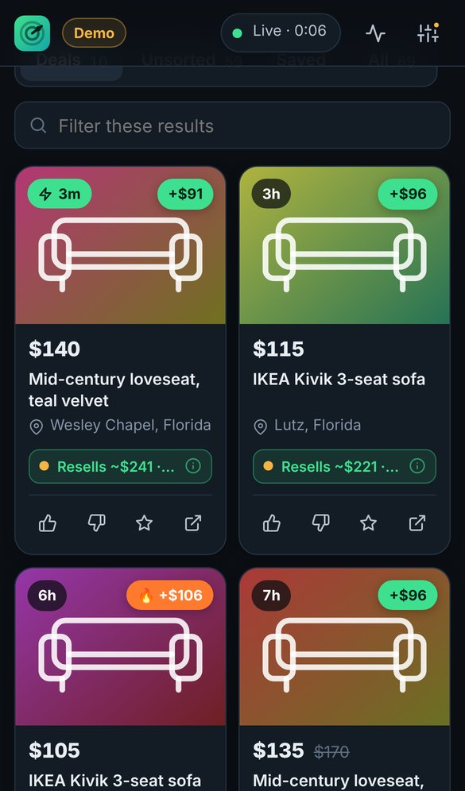
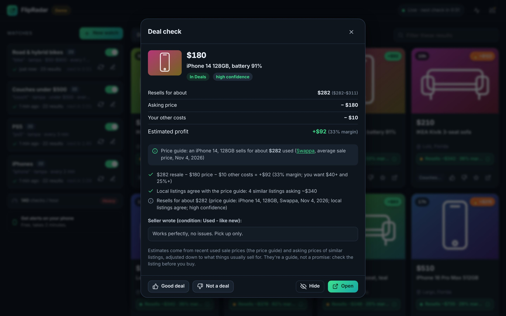

# FlipRadar

**See new Facebook Marketplace listings within minutes of posting, and get pinged only for the ones worth flipping.**

FlipRadar watches the Marketplace searches you care about, newest first. Every new listing is checked as a flip: what it resells for, what you'd make after costs, and red flags. Good deals go to your **Deals** pile and your phone. Everything else lands in an **Unsorted** pile with the reason, so a wrong call never costs you a listing.

<p align="center">
  
  
</p>

## What it does

- **Fast.** Each search is checked every 3 minutes by default (you can pick 1 to 60). New listings reach your phone a few seconds after the check that finds them.
- **Phone alerts.** Free [ntfy](https://ntfy.sh) app (no sign-up), Discord or Telegram. Each alert shows the price, title, photo and how long ago it was posted, and opens the listing when tapped.
- **Smart filters.**
  - Skips listings with words you don't want ("broken", "for parts", "ISO"…), with one click to add common junk words.
  - Hides "$1, message me" bait listings. Free items still show.
  - Ignores old listings that Facebook bumps back to the top. It reads each listing's real posting time.
  - Never alerts twice for the same listing, even if two searches find it.
- **Deal checking.** Every listing gets an estimated resale price, profit and margin, plus a plain reason. Possible deals get a closer look at the full listing before you're alerted. See [How it decides what's a deal](#how-it-decides-whats-a-deal).
- **Built-in price guide.** Recent used sale prices for 35 popular flips (PlayStation, Xbox, Switch, Steam Deck, Meta Quest, iPhone 13–16, Galaxy S24 Ultra, iPad, AirPods Max), each with its source and date. Those items can be judged from the very first listing, with no price history needed.
- **Two piles, nothing lost.** **Deals** alert you. **Unsorted** keeps everything else with its reason, like "only +$12 profit" or "for parts (doesn't turn on)". 👍/👎 any listing to move it, and FlipRadar keeps score of how often it was right.
- **Optional AI second opinion.** With your own Anthropic API key, Claude identifies the exact item, reads the condition and photo, and estimates what it really sells for. It only checks possible deals, with a daily cap.
- **Gentle on Facebook.** It runs one check at a time with randomized timing, backs off automatically, and pauses everything if Facebook pushes back instead of hammering it. Optional quiet hours overnight.
- **Clean dashboard.** A live feed with photos, Deals / Unsorted / Saved tabs, a "why?" breakdown on every listing, and an activity log. It works on your phone too.

## Try it in 1 minute without Facebook

There's a demo with a pretend Marketplace that posts new fake listings every 20–60 seconds:

```bash
npm install
```

```bash
npm run demo
```

Then open http://localhost:3000.

## Set it up for real

You need a computer that stays on while you want alerts. Your everyday Windows or Mac computer is fine. **Use your home internet:** Facebook usually blocks cloud servers.

1. **Install Node.js.** Download the "LTS" version from https://nodejs.org and install it.
2. **Download FlipRadar.** On GitHub, click **Code → Download ZIP**, then unzip it.
3. **Start it.**
   - **Windows:** double-click `start.bat`.
   - **Mac:** double-click `start.command`. If macOS says it's from an unidentified developer, right-click it → **Open**.
   - **Anything else:** run `npm install` once, then `npm start`.

   Your browser opens http://localhost:3000. Keep the black terminal window open; closing it stops FlipRadar.
4. **Add a watch.** Click **New watch**. The easiest way: on Facebook, search Marketplace with your location and filters, copy the address bar, and paste it in. Or just type what you want, your city, and a price range.
5. **Turn on phone alerts.** Click the settings icon (top right) and follow the three ntfy steps, then tap **Send test**.

That's it. New listings appear on the dashboard and on your phone.

## How it decides what's a deal

<p align="center"></p>

Resellers judge a flip by what an item actually **sells** for, minus every cost. FlipRadar does the same, in four steps:

1. **Red flags first.** "For parts", "doesn't turn on", iCloud-locked, "ISO"/wanted posts, replicas, rentals and payment plans, box-only listings, and scam wording (deposits, "shipping only", "pay first", "Zelle only"). Negations don't count: "not broken" and "no scratches" are fine.
2. **What it resells for.** In order of trust:
   - **Your number.** Set "Resells for about" on a watch, and FlipRadar uses it. Exceptions: if the item is clearly something cheaper (a PS4 Pro in a PS5 search, per the price guide) or similar listings sell for far less (a $45 controller), it trusts those instead.
   - **The price guide.** For the [popular items it knows](#the-price-guide), what they actually sold for used, recently. It's strict about matching: "PS5 controller", "case for iPhone 15" and "iPhone 16e" get no guide price.
   - **Similar listings.** FlipRadar remembers 30 days of prices. It compares each listing with ones whose titles share real words beyond your search words, so controllers are compared with controllers, not consoles. Marketplace prices are *asking* prices, so it assumes items sell for 90% of asking (adjustable).
   - **Both together.** When local listings agree with the guide, the call is high confidence. When they disagree, FlipRadar uses the **lower** number. Local prices are often lower than national ones, and that's what you'll actually get.
   - **The optional AI**, cross-checked against the above. When the AI disagrees, FlipRadar uses the lower number and marks the call less certain.
   - **Condition.** A seller-listed "Used – fair" counts 15% lower, "poor" 30% lower. That's a rule of thumb, not data. Listings missing what normally comes with the item ("no controller", "tablet only") are marked less certain.
3. **Profit.** Resale − asking price − selling fees − your other costs (gas, cleaning, time; $10 by default). Selling locally has no fees. eBay is counted at 13.6% + $0.40 per sale + the shipping you enter. Published 2026 figures range from 12.9% to 13.6%, so check your own fees in eBay Seller Hub.
4. **Verdict.** It's a **deal** only if the profit is at least $40 **and** at least 25% of the resale price, nothing blocks it, and the estimate is at least medium confidence. All of these are adjustable in Settings. Anything unsure goes to **Unsorted** with the reason.

**Before alerting about a possible deal**, FlipRadar opens the full listing to read the description and condition, since problems often show up only there. With the AI on, Claude takes a look too. Deal alerts go out right after, usually within seconds.

**Too good to be true?** These count as likely scams and never alert:

- a price under about 12% of resale value;
- a deposit, "pay first" or "shipping only" request on anything priced like a deal (under 65% of resale);
- "Zelle / Cash App only" at under 40% of resale. (Payment apps alone are normal with honest sellers.)

Between 12% and 25% of resale it can still be a deal, with a "see it in person before paying" warning. If something is far under *your* resale price or the guide price and no local listings confirm it's the same item, it goes to Unsorted as "check it is the same item".

**How accurate is it?** It's a careful estimate, not a guarantee:

- **Items in the price guide** can be judged from the first listing. For everything else, there's little price history on day one, so expect more "not enough price info" in Unsorted. It gets sharper as listings come in.
- For the most accurate calls on other items, give each watch a "resells for" price, or turn on the AI.
- **A labeled test set** of 71 realistic listings (deals, fair prices, accessories, broken and locked items, scams, missing parts, unknown models) checks the rules. Run `npm run accuracy` for the report. Currently: 70 of 71 right, **0 false alarms**, 1 missed deal on purpose (a PS5 sold without its controller, kept in Unsorted because it's worth less than a complete one). These are hand-written examples, so they show the rules work as designed, not real-world accuracy.
- Use 👍/👎 on listings. FlipRadar shows how often its deals were right, so you can see whether to tighten your rules.

### The price guide

Used sale prices collected **November 4, 2026**, stored with their sources in [`src/data/price-guide.json`](src/data/price-guide.json). Settings → Deal rules has the full list and an on/off switch.

| Items | Source | Price used |
| --- | --- | --- |
| PlayStation 5 (original, Slim, Pro), PlayStation 4 (original, Slim, Pro), Xbox Series X and S, Nintendo Switch (original, OLED, Lite, Switch 2) | [PriceCharting](https://www.pricecharting.com/) | "Loose" (used, no box), from completed eBay sales |
| iPhone 13–16 (base, Pro, Pro Max), Galaxy S24 Ultra, Steam Deck (LCD, OLED), Meta Quest 2 / 3 / 3S, iPad 9th and 10th gen, AirPods Max | [Swappa](https://swappa.com/prices) | Average sale price, base storage size |

Good to know:

- **Prices are national, online sale prices.** Local Marketplace prices are often lower; when local listings disagree, the lower number wins.
- **Base storage only** for phones and tablets, so bigger sizes are underestimated. That's the safe direction.
- **PS5 Pro** used prices were unusually high and jumpy in late 2026, so the guide alone never makes a PS5 Pro a deal: local listings have to agree.
- **Not covered yet:** MacBooks, AirPods Pro, game controllers, graphics cards, Dyson, KitchenAid and anything else. Those use your own number, similar listings, or the AI.
- **Prices drift.** After 6 months the guide counts as old and can't trigger an alert on its own. To refresh it, update the `price` numbers and `asOf` date in the file from the source links, then restart.

### AI second opinion (optional)

Settings → **AI second opinion**: paste an Anthropic API key from [console.anthropic.com](https://console.anthropic.com/settings/keys), switch it on, and tap **Test the AI**.

- **Which model.** Claude Opus 5.5 is the default and most accurate (about 3¢ per check). Sonnet 5.5 costs about 1–2¢ and Haiku 5.5 about 0.1¢.
- **Cost control.** Only possible deals are checked, and there's a daily cap (60 by default). Today's spend shows in Settings.
- **Refusals.** If the model declines a request for policy reasons, Anthropic retries it on its recommended fallback model.

## How fast is "fast"?

How quickly you hear about a listing depends on three things:

1. **How long Facebook takes to show it in search.** Usually quick, sometimes a few minutes. No tool can beat this part.
2. **When the next check runs.** With the default 3-minute interval, that's 0–3½ minutes, about 1½ minutes on average.
3. **Delivery to your phone.** A few seconds.

So expect most alerts within about **1–5 minutes** of a listing appearing. A 1–2 minute interval gets you there sooner, at a higher chance of Facebook slowing you down. The meter under your watches shows your total checks per hour: **Gentle** (≤60), **Moderate** (≤120) or **Heavy**.

## Facebook access, honestly

Facebook has **no public Marketplace API** (official way for apps to request data). FlipRadar reads the same search page your browser does. That means:

- **Fast mode (default) needs no login.** It loads the public search page like a logged-out visitor. It works best from a home internet connection.
- **If Facebook starts asking for a login,** you'll see a yellow banner. Click **Connect Facebook**. A browser window opens; log in once and it closes by itself. The login is saved only on your computer, in `data/browser-profile`. From then on, FlipRadar uses a real background browser when fast mode is blocked (**Auto** mode).
- **Use a spare Facebook account if you can.** Facebook's terms don't allow automated collection. The realistic risk is that Facebook limits or locks the account you connect. Logged-out fast mode doesn't involve an account. Gentle check speeds keep the risk low.
- **Facebook changes its website often.** If something breaks, the watch shows a warning, and the **Activity** log (pulse icon, top right) says exactly what happened. FlipRadar doesn't depend on one fixed page layout: it searches the page data for anything shaped like a listing. That makes it more resistant to Facebook's changes than most scrapers.

**Servers and Docker:** these have no screen for the login window. Use **Settings → Facebook connection → Advanced: paste cookies** instead. Export your facebook.com cookies with a cookie-export browser extension and paste them there.

## Phone alerts

| Option | Setup | Notes |
| --- | --- | --- |
| **ntfy** (recommended) | Install the free ntfy app ([iPhone](https://apps.apple.com/app/ntfy/id1625396347), [Android](https://play.google.com/store/apps/details?id=io.heckel.ntfy)), tap **+**, subscribe to the topic shown in Settings. | No account. Shows photos. Your topic name works like a password, so keep it private. |
| **Discord** | Channel settings → Integrations → Webhooks → New webhook → copy the URL into Settings. | Nice for sharing with a partner or team. |
| **Telegram** | Message **@BotFather** → `/newbot` → copy the token. Get your chat ID from **@userinfobot**. | |

While the dashboard is open, it also plays a sound and can show desktop notifications (Settings → This browser).

## Running it all the time

- **Simplest:** leave your computer on with the FlipRadar window open. Turn off sleep in your power settings.
- **Docker / Raspberry Pi (64-bit):**

  ```bash
  docker compose up -d --build
  ```

  Then open http://localhost:3000 on that machine. Edit `docker-compose.yml` to set your time zone. To open it from your phone on the same Wi-Fi, set a `PASSWORD` and change the port line as the comments there explain.

## Settings you can change when starting

| Variable | Default | What it does |
| --- | --- | --- |
| `PORT` | `3000` | Dashboard port. |
| `HOST` | `127.0.0.1` | Use `0.0.0.0` to allow other devices on your network (set `PASSWORD` too). |
| `PASSWORD` | none | Password-protect the dashboard. |
| `DATA_DIR` | `./data` | Where settings, listings and the browser login are stored. |
| `BROWSER_PATH` | auto | Full path to Chrome/Edge/Chromium if it isn't found automatically. |
| `FB_USER_AGENT` | recent Chrome | Browser identity string used in fast mode. |

## Troubleshooting

- **"Facebook wants a login"**: click **Connect Facebook** in the banner (or paste cookies on a server).
- **"Location not recognized"**: edit the watch and paste a Marketplace search link instead of typing the city.
- **"Empty page from Facebook"**: this happens now and then. FlipRadar retries automatically. If it keeps happening, switch Settings → Facebook connection to **Auto** or **Browser only**.
- **"No browser found"**: install Google Chrome, or run `npm run setup-browser` to download Chromium.
- **"Port 3000 is already in use"**: FlipRadar is probably already running. Otherwise start it with `PORT=3001`.
- **No phone alerts**: open Settings and tap **Send test**. Any error shows next to the channel name.

## How it works (for the curious)

- **Search:** every watch becomes a Marketplace search link forced to *Date listed: newest first* and *last 24 hours*, so new posts are always on page one.
- **Reading listings:** Facebook embeds the first page of results as JSON (structured data) inside the page. Instead of trusting one fixed path through that data, FlipRadar walks all of it and keeps every object shaped like a listing: one with an `id` and a `marketplace_listing_title`. It skips sponsored stories. In browser mode, it also reads Facebook's own data responses, and as a last resort the visible listing cards. See `src/facebook/extract.js`.
- **Fast mode** sends the same headers Chrome sends when opening a page, and keeps Facebook's guest cookie like a returning visitor (`src/facebook/http.js`). **Browser mode** drives your installed Chrome or Edge with its own profile (`src/facebook/browser.js`).
- **New vs. old:** the first check of a watch is a quiet baseline. After that, a listing alerts if FlipRadar hasn't seen it before *and* it was posted within your alert window, 60 minutes by default (`src/monitor.js`).
- **Deals:** red flags, resale estimate, profit math and the verdict live in `src/evaluate.js`. The price guide matcher is `src/priceguide.js`. The closer look (full listing, then AI) runs in `src/monitor.js`, and the optional AI is in `src/ai.js`.

```text
src/
  server.js          web server, JSON API, live updates (Server-Sent Events)
  monitor.js         scheduler: timing, backoff, new-listing detection, alerts
  evaluate.js        the deal check: red flags, resale estimate, profit, verdict
  priceguide.js      matches a listing to the price guide (strictly)
  data/              price-guide.json: used sale prices, sources, dates
  ai.js              optional AI second opinion (Claude)
  deals.js           your filters and text helpers
  notify.js          ntfy, Discord, Telegram
  store.js           saves everything to data/db.json
  facebook/          links, page reading, fast mode, browser mode
public/              the dashboard (plain HTML, CSS and JavaScript)
tools/               pretend Marketplace, demo, accuracy report
test/                automated tests; fixtures/ holds the labeled test set
```

Run the tests with `npm test`. They include a full run against the pretend Marketplace, the labeled accuracy set, and, when Chrome or Chromium is installed, the real browser mode. `npm run accuracy` prints the accuracy report.

---

FlipRadar is not affiliated with, endorsed by, or connected to Facebook or Meta. It's meant for personal use at reasonable speeds.
